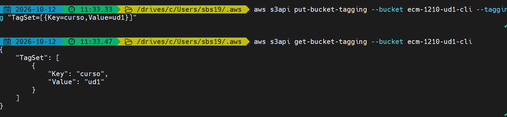

# UD1. Mi primer recurso
 
**Alumno/a:** Nombre y apellidos
 
## 1. Laboratorio
- Crédito inicial:
- Crédito final:

`Comando consola`

``` lineas de ```

```consola ```
## 2. Bucket desde la consola

 
## 3. Bucket desde la CLI
(aquí los comandos y sus salidas)
 
## 4. Comparación
(tabla)
 
## 5. Reflexión
(cinco líneas)
 
## 6. Evidencia de borrado
(salida de aws s3 ls)
